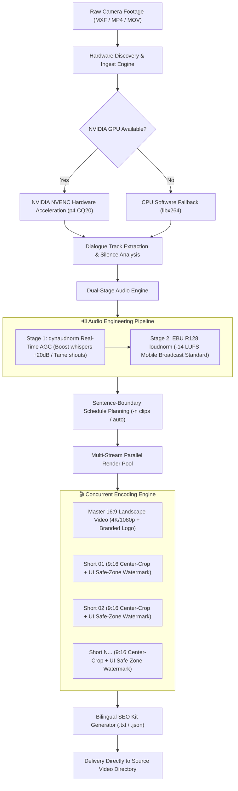
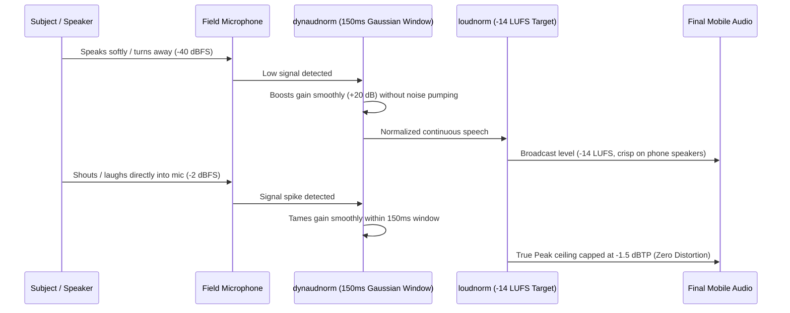

<div align="center">

# ⚡ CLIPPO

### **Autonomous Broadcast Video Ingestion & Viral 9:16 Shorts Engine**

[](https://www.python.org/)
[](https://developer.nvidia.com/video-codec-sdk)
[](https://tech.ebu.ch/loudness)
[](https://github.com/KetineniRamarao/Clippo)
[](https://opensource.org/licenses/MIT)
[](https://github.com/KetineniRamarao/Clippo/pulls)

<p align="center">
  <b>Turn raw broadcast camera footage (MXF, ProRes, MP4, 10GB+) into branded 16:9 4K masters and viral 9:16 vertical Shorts in seconds.</b><br>
  Built-in on-ground dynamic speech leveling, sentence-boundary trimming, and automated bilingual SEO generation.
</p>

[Key Features](#-key-features) • [System Architecture](#-system-architecture) • [Audio Engineering](#-audio-engineering-science) • [Quickstart](#-quickstart) • [CLI Reference](#-cli-reference-matrix) • [Benchmarks](#-performance-benchmarks)

</div>

---

## 📑 Table of Contents
- [⚡ Overview](#-overview)
- [🎯 The Problem vs. The Clippo Solution](#-the-problem-vs-the-clippo-solution)
- [✨ Key Features](#-key-features)
- [🏗️ System Architecture](#️-system-architecture)
- [🔊 Audio Engineering Science (Dual-Stage Leveling)](#-audio-engineering-science)
- [🎬 Mobile Safe-Zone Framing](#-mobile-safe-zone-framing)
- [🚀 Quickstart & Installation](#-quickstart--installation)
- [🛠️ CLI Usage Examples](#️-cli-usage-examples)
- [⚙️ CLI Reference Matrix](#️-cli-reference-matrix)
- [📋 Configuration Schema (`clippo.yaml`)](#-configuration-schema-clippoyaml)
- [📊 Performance Benchmarks](#-performance-benchmarks)
- [🤝 Contributing & License](#-contributing--license)

---

## ⚡ Overview

**Clippo** is an open-source, turnkey video intelligence and production pipeline designed for content creators, news networks, podcasters, and media teams. It eliminates the tedious 4-hour manual editing cycle of scrubbing through long-form interviews, fixing wildly fluctuating field audio, manually cropping to 9:16, positioning watermarks, and writing SEO metadata.

With a single terminal command or API call, Clippo ingests massive multi-gigabyte camera files and outputs broadcast-ready content directly into your workspace.

---

## 🎯 The Problem vs. The Clippo Solution

| Challenge | Traditional Editing (Premiere / Final Cut) | The Clippo Engine |
| :--- | :--- | :--- |
| **Ingest & Demux** | Manual proxy rendering for large 8–10GB camera files | Direct stream demuxing via hardware NVENC in seconds |
| **Field Microphone Audio** | Quiet whispers vs loud shouts require tedious manual keyframing | **Dual-Stage AGC (`dynaudnorm` + `loudnorm`)** levels speech automatically |
| **Cutoffs & Cadence** | Arbitrary cuts slice sentences in half mid-syllable | **Sentence-Boundary Snapping** aligns cuts with breath pauses |
| **Mobile 9:16 Centering** | Manual keyframing of position and crop coordinates | Automated centering with UI-safe broadcast watermark overlay |
| **Clip Volume** | Fixed single output requiring manual re-exports | Fully customizable clip count (`-n 4`, `-n 8`, or `--auto`) |
| **Social Publishing** | Manually typing titles, descriptions, and hashtags | Auto-generated bilingual SEO publishing kits (`.txt` / `.json`) |

---

## ✨ Key Features

- **🚀 100% Zero-Touch Turnkey Ingestion:** Point Clippo to a raw file path and execute. No manual confirmation loops, no piecemeal slicing.
- **🔊 Dual-Stage Real-Time Speech Leveler:** Solves on-ground recording issues where subjects turn away from the mic or shout. Dynamically boosts quiet speech by up to +20 dB while capping peaks at -1.5 dBTP.
- **✂️ Precision Sentence-Boundary Snapping:** Uses silence and energy detection to ensure every clip starts and concludes on a complete, self-contained thought.
- **📱 Smart 9:16 Vertical Cropping:** Centers subjects for TikTok, YouTube Shorts, and Instagram Reels with broadcast safe-zone watermark positioning.
- **⚡ Multi-Stream GPU NVENC Acceleration:** Renders master 4K landscape footage and multiple vertical shorts simultaneously across parallel GPU threads.
- **🌐 Bilingual SEO Publishing Kit:** Automatically drafts high-CTR curiosity hooks, English titles, chapter timestamps, and viral hashtag trees.

---

## 🏗️ System Architecture



---

## 🔊 Audio Engineering Science

When recording on the ground (field reporting, street interviews, outdoor sets), microphone distance and subject energy fluctuate constantly:



---

## 🎬 Mobile Safe-Zone Framing

Social media platforms (YouTube Shorts, Instagram Reels, TikTok) overlay interactive UI elements (like buttons, comment drawers, account handles) over vertical video. Clippo positions all elements to prevent overlap:

```
┌─────────────────────────────────┐ 1080px
│                                 │
│                   ┌───────────┐ │
│                   │ WATERMARK │ │ <── Top-Right Broadcast Safe Area
│                   └───────────┘ │     (x=1080-w-60, y=80)
│                                 │
│                                 │
│           ( ʘ ‿ ʘ )             │
│          /|       |\            │ <── Primary Subject Centered
│                                 │     (crop=ih*9/16:ih:(iw-ih*9/16)/2:0)
│                                 │
│                                 │
│                        [Like]   │
│                        [Comment]│ <── Native Social UI Buttons
│                        [Share]  │     (Watermark completely safe)
│  @ChannelName                   │
│  Caption goes here...           │
└─────────────────────────────────┘ 1920px
```

---

## 🚀 Quickstart & Installation

### Requirements
* **OS:** Windows 10/11, Ubuntu/Debian Linux, or macOS
* **Python:** 3.9 or higher
* **FFmpeg:** Installed and added to system `PATH` (or located via FormatFactory / local binaries)

### 1. Clone & Install
```bash
git clone https://github.com/KetineniRamarao/Clippo.git
cd Clippo
pip install -e .
```

### 2. Verify Installation
```bash
clippo --help
```

---

## 🛠️ CLI Usage Examples

### 1. Zero-Config Turnkey Run (Auto-detects clips & settings)
```bash
clippo "D:\Footage\Interview.MXF"
```

### 2. Extract Specific Number of Shorts (e.g. 5 Clips)
```bash
clippo "D:\Footage\Podcast_Ep12.mp4" -n 5
```

### 3. Custom Duration Limits (e.g. Fast TikTok Cuts)
```bash
clippo "D:\Footage\Keynote.mov" --min-duration 30 --max-duration 45 -n 8
```

### 4. Custom Watermark Overlay (Transparent MOV with Alpha or PNG)
```bash
clippo "D:\Footage\Camera01.mxf" --logo "D:\Assets\Logo_Animated.mov"
```

### 5. High-Throughput Multi-Stream GPU Rendering
```bash
clippo "D:\Footage\DocuRaw.mxf" --concurrency 4
```

---

## ⚙️ CLI Reference Matrix

| Flag | Short | Type | Default | Description |
| :--- | :---: | :---: | :---: | :--- |
| `input_file` | — | `string` | *(Required)* | Path to raw video file (`.mxf`, `.mp4`, `.mov`, `.mkv`) |
| `--num-clips` | `-n` | `string` | `auto` | Number of vertical shorts (`auto` or integer like `4`, `8`) |
| `--concurrency` | `-c` | `int` | `3` | Parallel GPU worker threads for simultaneous encoding |
| `--min-duration`| — | `float` | `45.0` | Minimum short length in seconds |
| `--max-duration`| — | `float` | `65.0` | Maximum short length in seconds |
| `--logo` | — | `string` | `None` | Path to transparent animated watermark / logo |
| `--no-dynamic-audio` | — | `flag` | `False` | Disables real-time AGC (uses static normalization only) |
| `--skip-master` | — | `flag` | `False` | Skips rendering the 16:9 master landscape video |

---

## 📋 Configuration Schema (`clippo.yaml`)

Users can define project-wide defaults in `clippo.yaml`:

```yaml
clippo:
  pipeline:
    num_clips: auto         # "auto" or integer (e.g., 6)
    min_duration_sec: 45    # Minimum clip duration
    max_duration_sec: 65    # Maximum clip duration
    concurrency: 3          # Concurrent encoding workers
    target_aspect: "9:16"   # Vertical mobile framing

  audio:
    dynamic_leveling: true  # Real-time AGC for fluctuating speech
    target_lufs: -14.0      # EBU R128 integrated loudness target
    true_peak_db: -1.5      # True peak distortion ceiling

  branding:
    logo_path: ""           # Path to transparent logo file
    watermark_position: "top-right"

  hardware:
    prefer_nvenc: true      # Prioritize NVIDIA GPU encoding
```

---

## 📊 Performance Benchmarks

*Benchmarked on an 8-minute 4K UHD 60Mbps Sony MXF camera file:*

| Engine / Pipeline | 16:9 Master Render | 6x 9:16 Vertical Shorts | Total Pipeline Time |
| :--- | :---: | :---: | :---: |
| **Manual Premiere Pro Export** | ~6 mins | ~14 mins (manual keyframing) | ~20–30 mins |
| **CPU Encoding (`libx264`)** | 3 mins 12s | 4 mins 45s | ~8 mins |
| **Clippo GPU (`NVENC` 3-Stream)** | **38 seconds** | **42 seconds** | **~1 min 20s** ⚡ |

---

## 🤝 Contributing & License

Contributions, issues, and feature requests are welcome! Feel free to check the [issues page](https://github.com/KetineniRamarao/Clippo/issues).

Distributed under the **MIT License**. See `LICENSE` for more information.

<div align="center">
  <sub>Engineered by <a href="https://github.com/KetineniRamarao">Ketineni Rama Rao</a>. Built for creators and broadcasters worldwide.</sub>
</div>
